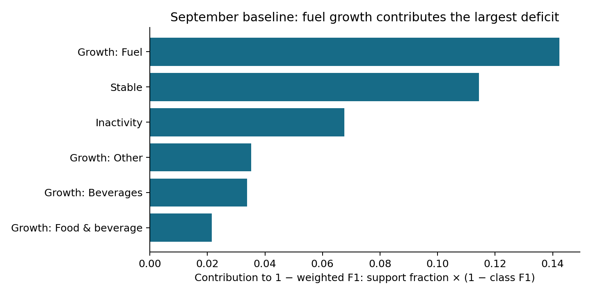

# October 14: baseline reproduction and rejected next-round experiments

**The public baseline remains 0.309164264. No eligible replacement CSV was produced.** All six June/September baseline component metrics reproduced exactly.

The calendar experiment failed its preregistered gates for all targets. Fuel's mean June/September RMSE gain was only 0.0002733824, below 0.001, and December worsened. Opportunity lost on September and nonfuel lost on both main dates. Calendar bootstrap intervals included zero.

The fuel-rule correction lost 0.0165190 / 0.0187310 weighted F1 on June/September. Its matched correction control also lost against the original classifier, showing that replacing the whole probability head caused much of the deterioration. Rule inputs improved that control on September but hurt it on June. Purchase/event Brier scores improved after calibration; this did not make the categorical predictions competitive. The paired customer-cluster F1-gain interval was [-0.0223117, -0.0103641], conditional on these reused dates.

The original generator, accepted components and realized submission bytes remain unchanged. No gate was relaxed after failure, and no extra-date acceptance tests or final test-population candidate fitting were run for ineligible models.

- [Protocol, equations, seeds, corrections and reproduction](../experiments/next_round/README.md)
- [Original execution brief](../experiments/next_round/EXECUTION_BRIEF.md)
- [Full corrected report](oct14_evidence/RESULTS.md)
- [Machine-readable evidence](oct14_evidence/)
- [Calendar proposal](oct14_evidence/calendar_proposal.json) and [decision](oct14_evidence/calendar_decision_corrected.json)
- [Fuel-rule proposal](oct14_evidence/rule_proposal.json) and [decision](oct14_evidence/rule_decision.json)

## Audit implications

Fuel growth remains the largest weighted F1 deficit, with September support 1,435 and F1 0.4803745. Only one eligible fuel-growth event lost to a competing category, so that competition is a weak explanation for the main fuel error. The seasonal backtest has one training origin and absent prior-year history; it cannot isolate a seasonal cause. Later-tuned decision multipliers were excluded from December scoring before candidate fitting.

The experiment does not establish that rule signals are useless: the matched head itself performed poorly. A future proposal would need to preserve a competitive baseline probability head and provide new evidence before changing it. No further variant was searched in this round.

